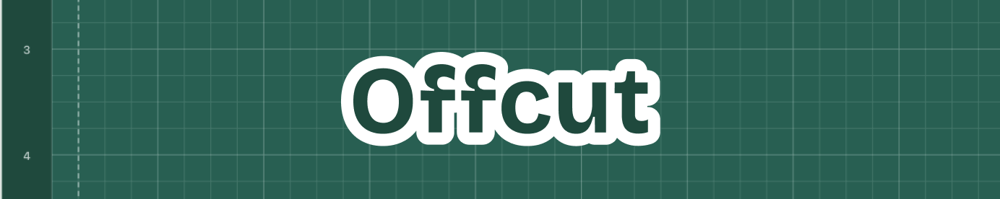
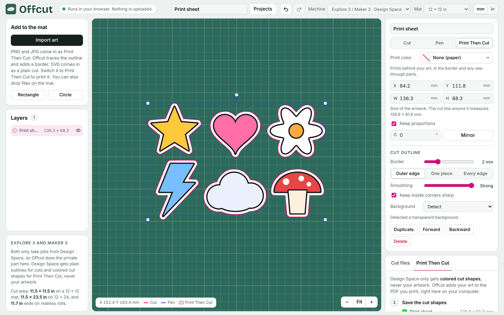
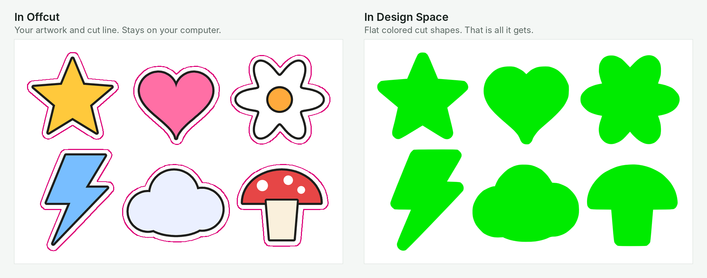

**Use Print Then Cut and keep your original artwork on your laptop.**

Everything you upload to Design Space is stored on Cricut's servers, and since their [latest terms update](https://cricut.com/en-us/legal) they have wide rights over it. I didn't want my art ending up in AI training, so I made Offcut.

- Runs in your browser. No install, no account, nothing uploaded.
- Design Space only gets plain colored shapes to cut around.
- Your artwork always stays on your computer. Offcut only uses it there to make the PDF you print.

---

## Table of contents

- [How it works](#how-it-works)
  - [What stays private, and what doesn't](#what-stays-private-and-what-doesnt)
- [Get started](#get-started)
- [Step by step](#step-by-step)
- [Features](#features)
- [Limits](#limits)
- [Privacy](#privacy)
- [Disclaimer](#disclaimer)
- [License](#license)

## How it works

1. **Import your art.** A PNG, JPG or SVG, one single design or a whole sheet. Offcut draws the cut line around it.
2. **Save the cut shapes.** Offcut saves a file with just the outline of each piece, filled with a flat color. There's no artwork in it.
3. **Upload the shapes to Design Space** and set them to Print Then Cut, like you normally would.
4. **Save the print page as a PDF** instead of printing it. It has your shapes plus the black marks the machine reads.
5. **Open that PDF in Offcut.** Offcut replaces each colored shape with your real artwork, in exactly the same spot.
6. **Print the new PDF and cut.** The machine reads the marks and cuts around your art.

### What stays private, and what doesn't

- **Stays on your computer:** your artwork, colors, images and project files.
- **Goes to Design Space:** the cut outlines (the silhouette of each piece) and where they sit on the page.
- For plain vinyl or paper cuts (the **Cut files** tab), the cut lines *are* the design, so Design Space gets those shapes.

## Get started

- **Online:** open the link under **About** on this page.
- **Offline:** download `index.html` and open it in your browser. Everything works without internet. On a Mac you can drag it to the Dock.

Projects save automatically in your browser, on your computer. The online version and a downloaded copy each keep their own list, so use **Projects › Save this project as a file** to back up or move a project.

## Step by step

> [!TIP]
> **Test first.** Print and cut once on plain paper to check everything lines up before you use your final material.

**In Offcut**

1. Set **Machine** to your machine and **Mat** to the mat you'll use.
2. Click **Import art** and pick a PNG, JPG or SVG. For several designs, put them all in one file. Offcut traces each piece.
   - PNG and JPG come in set to Print Then Cut.
   - SVG comes in as a plain cut. Click **Print Then Cut** to print it.
3. Check the size. **W** and **H** show the size of the artwork itself. For PNG and JPG, Offcut reads the size from the file's DPI.
4. Under **Cut outline**, set the border and smoothing. Tick **Keep inside corners sharp** if you want smooth outer curves but crisp notches.
5. Want a colored border, or a shape printed in a color? Pick it under **Print color**.
6. Open the **Print Then Cut** tab, pick your paper and click **Save cut shapes (SVG)**.

**In Design Space**

7. Upload the cut shapes SVG and check its size matches what Offcut shows.
8. Select all its layers and set **Operation** to **Print Then Cut**. With more than one layer, click **Flatten** so your layout stays as it is.
9. Click **Make It**, **Continue**, then **Send to Printer**.
10. Turn **Add Bleed** off and **Use System Dialog** on, then click **Print**.
11. In the print window, save as PDF. On a Mac: **PDF › Save as PDF**. On Windows: **Microsoft Print to PDF**.

**Back in Offcut**

12. Click **Open the Design Space PDF**. Offcut shows each match.
13. Click **Save print-ready PDF** and print it at **100% / Actual size**, with no fit-to-page.
14. Put the sheet on the mat and carry on in Design Space. If you closed it, open the project, click **Make It** and choose **I have already printed**.

## Features

- Cut lines traced from PNG, JPG or SVG: outer edge, one piece or every edge
- Adjustable border, smoothing, and sharp inside corners
- Print color for borders and shapes, with basic, recent and custom colors
- SVG art prints at full sharpness
- Real-size import from the image's DPI
- Whole sheets of designs in one go, including rotated copies
- Matching that handles bleed and sub-millimeter shifts
- Plain cuts and pen lines, exported as SVG for Design Space
- Projects saved in the browser, plus project files for backup
- Light and dark mode

**Other machines (experimental):** direct cutting over USB for GRBL plotters and a Maker 1 running the open-source [CutCutGo](https://github.com/virtualabs/cutcutgo) firmware, in Chrome or Edge. Explore 3 and Maker 3 only take jobs from Design Space, which is why Offcut sends them cut shapes instead.

## Limits

- Offcut doesn't replace Design Space. You still need it installed and signed in.
- It relies on how Design Space lays out its Print Then Cut page. An update there could break matching.
- Print Then Cut size limits still apply: 7.2 × 10.62 in on A4, 7.44 × 9.94 in on US Letter.
- Tested with an Explore 3, in Safari on macOS and in Chrome.

This is a personal project. I can't promise support, but issues and fixes are welcome.

## Privacy

Offcut makes no network requests. Everything it needs, including the PDF reader ([pdf.js](https://mozilla.github.io/pdf.js/)) and the [Inter](https://rsms.me/inter/) font, is inside the file. No analytics, no cookies, no server. Projects are stored in your browser on your device, and clearing your browser's site data deletes them.

## Disclaimer

Offcut is an independent project. It is not affiliated with, endorsed by or sponsored by Cricut, Inc. Cricut and Design Space are trademarks of Cricut, Inc., used here only to describe compatibility. Use it at your own risk and test on plain paper first.

## License

[MIT](LICENSE). Offcut includes pdf.js by Mozilla (Apache License 2.0) and the Inter font (SIL Open Font License 1.1), see [THIRD_PARTY_NOTICES.md](THIRD_PARTY_NOTICES.md).
